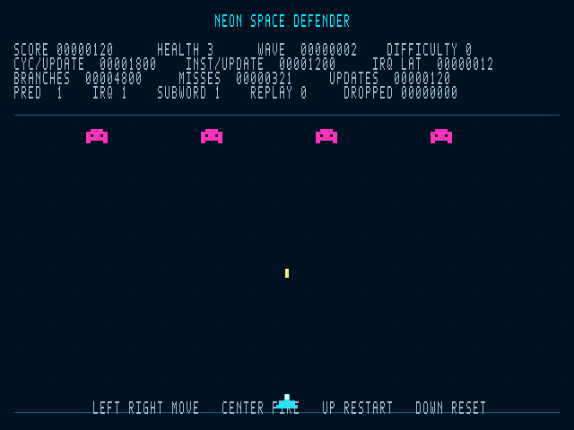

# Neon Space Defender: build, play and verify

This directory contains the game firmware, a dedicated Verilog board top, the display/input/performance peripherals, and executable tests. The existing enhancement-test top and `lab4/AA_IROM.mem` are separate and remain usable.

The target is the **Nexys4 DDR / Artix-7 xc7a100tcsg324-1** pinout already present in this repository. Confirm that this is the board you are programming. The new top is **`NeonTop`**, not the historical VHDL `TOP`.

## 1. What is implemented

- RISC-V assembly runs movement, firing, four enemies, four bullets, collisions, damage, score, wave progression, game over and restart.
- One 25 MHz clock drives the CPU and video. VGA is 640×480 with 800×525 totals, approximately **59.524 Hz**, negative sync. The original asynchronous CPU memory contract is preserved.
- Left/right/fire/start buttons are synchronized and debounced. Switch settings are latched at hardware reset.
- Display records and HUD values are published atomically at the start of vertical blank. Hardware renders CPU-provided state; it does not run the game rules.
- Prediction bypass, polling/interrupt scheduling, and direct-subword/word-mask routines coexist in one firmware image.
- Real counters measure cycles, retired instructions, conditional branches/misses, load/MCycle stalls and IRQ entry/return. The HUD shows average update cost, branch totals, IRQ latency and missed update deadlines.
- A deterministic replay and independent Python gameplay specification check that all eight enhancement combinations produce the same gameplay result.

Optional audio is not part of this version.

The following preview is generated from the RTL renderer with fixed display records (a rendering fixture, not a photograph of a board):



## 2. Quick build

Run commands below from the **repository root** (`CG3207/labs`). You need Python 3, Java, the included `rars1_6.jar`, and Vivado for the FPGA build. The simulation tests use Icarus Verilog (`iverilog` and `vvp`).

```sh
python3 lab4/demo/scripts/assemble.py
python3 lab4/demo/scripts/test.py
vivado -mode batch -source lab4/demo/scripts/build.tcl -tclargs lab4/demo/build bitstream
```

Generated files are isolated in `lab4/demo/build/`:

| File | Purpose |
|---|---|
| `game.mem` | Assembled game, padded to the demo ROM capacity |
| `firmware.json` | Size and source/image SHA-256 identities |
| `test_results.json` | Results from the selected simulation run |
| `test_*.log` | Exact simulator output, including failures |
| `preview.ppm` | A complete raster produced by the actual RTL renderer test |
| `fpga/NeonTop.bit` | Final bitstream, created only after implementation/timing checks |
| `fpga/neon_synth.dcp`, `fpga/neon_routed.dcp` | Synthesis/implementation checkpoints |
| `fpga/*rpt` | Utilization, timing, DRC and clock reports |
| `fpga/neon_synth.v` | Functional post-synthesis netlist |

The game assembles to **1,046 words / 4,184 bytes** at initial implementation. The demo wrapper reserves **16 KiB instruction ROM and 4 KiB RAM**. `assemble.py` checks ROM overflow. Recheck `firmware.json` after edits; source line count is not a memory-size measurement.

**Do not replace `lab4/AA_IROM.mem` for this build.** The game top reads its dedicated `game.mem`. You do not need to modify the historical Wrapper's depth parameters or replace the enhancement test image.

For custom output directories, pass the same directory to each command:

```sh
python3 lab4/demo/scripts/assemble.py --out /tmp/neon-build
python3 lab4/demo/scripts/test.py --out /tmp/neon-build
vivado -mode batch -source lab4/demo/scripts/build.tcl -tclargs /tmp/neon-build bitstream
```

To create a GUI project instead of running the whole implementation immediately:

```sh
vivado -mode batch -source lab4/demo/scripts/build.tcl -tclargs lab4/demo/build project
```

Open the generated `build/project/neon.xpr`, confirm top `NeonTop`, then run synthesis/implementation/bitstream generation. The build script supplies the correct source set and constraints. Do not add the old VHDL top, old wrapper or duplicate modules from other labs to this project.

## 3. Program and play

1. Connect the FPGA board's VGA port to a monitor and connect/program through USB/JTAG.
2. Select the desired switches before releasing **DOWN/BTND** reset. For normal enhanced gameplay set **SW0, SW1, SW2 ON** and leave SW3–SW5 OFF.
3. Program `build/fpga/NeonTop.bit` with Vivado Hardware Manager.
4. You should see **NEON SPACE DEFENDER**, a score/metrics HUD, and **PRESS UP TO START**.
5. Press **UP/BTNU** to start. Use left/right to move and center to fire.

| Control | Action |
|---|---|
| LEFT / BTNL | Move left while held |
| RIGHT / BTNR | Move right while held |
| CENTER / BTNC | Fire; holding repeats with a cooldown |
| UP / BTNU | Start or restart a round |
| DOWN / BTND | Reset the CPU/game and latch new switch modes |
| SW0 | 1: predictor enabled; 0: sequential prediction with normal recovery |
| SW1 | 1: timer/button interrupts; 0: polling |
| SW2 | 1: direct byte/halfword access; 0: word/mask/shift access to the same packed state |
| SW3 | 1: automatic deterministic replay; 0: manual play |
| SW5:SW4 | Difficulty 0–3 |

Switch changes take effect only after **DOWN reset**. **UP restart** preserves the selected modes. No physical button pauses the clock; VGA continues running independently of CPU stalls.

The seven-segment display shows the score in decimal digits. Low LEDs show the numeric health value in binary, initially 3. The VGA HUD is the primary status display.

Game rules:

- The ship moves 5 pixels per simulation update and stays between x=16 and x=600.
- Up to four bullets can be active. Holding fire creates a new bullet when a slot and cooldown permit; a short debounced press is retained until the next update.
- Bullets move upward 8 pixels/update. A hit consumes the bullet and reduces enemy health. A destroyed enemy awards 10 points exactly once.
- Enemies move every eighth update, reverse at the side boundaries and descend. Difficulty increases their speed and, at levels 2–3, health.
- An enemy reaching the invasion line removes one player health. At zero health the game stops and displays GAME OVER.
- When all enemies are gone and the player is alive, the next wave starts. Wave progression increases descent distance, with a cap.
- UP starts a clean round with score 0, health 3 and wave 1.

## 4. First board acceptance checklist

Use **SW0–2 ON, SW3–5 OFF** first.

| Check | Expected behavior |
|---|---|
| Boot | Stable title/menu, no flicker, readable score and controls |
| Start | UP reveals ship and four enemies; state starts cleanly |
| Movement | LEFT/RIGHT move in the correct direction; ship clamps at edges |
| Fire | CENTER fires; holding repeats; releasing stops after queued press/cooldown behavior |
| Pool capacity | At most four bullets are visible; no out-of-bounds artifacts |
| Collision | Enemy takes damage/disappears; score increases by 10 on destruction, once |
| Wave | Clear all enemies; next formation appears and wave increments |
| Damage | Allow enemies to descend to the invasion line; health decreases |
| Game over | At zero health, GAME OVER appears and updates stop |
| Restart | UP restores score 0, health 3, wave 1 without reprogramming |
| Mode latch | Moving switches alone does not change HUD modes; DOWN applies them |
| Stalls | HUD, sync and video remain stable during CPU multiply/divide activity |
| Timing | DROPPED stays at zero under the normal workload |

Do not claim board validation until you have observed these results on the physical board. Save the matching `firmware.json`, bitstream and timing reports with your demonstration evidence.

## 5. Deterministic replay: strongest mode-comparison check

Enable **SW3**, choose SW0–2, keep difficulty **SW5:4 = 00**, and press DOWN. Replay starts automatically and completes after **600 simulation updates**, approximately 10 seconds of game time. It moves right/left in fixed 64-update intervals and fires continuously.

Expected standard difficulty-0 result:

```text
REPLAY COMPLETE
UPDATES 00000600
SCORE   00000030
HEALTH  3
WAVE    00000001
CHECKSUM 74E9EB63
```

All eight combinations of SW0–2 must reach the same checksum and gameplay state. Their performance values may differ. Press UP to repeat the same replay from a clean game state, or change switches and press DOWN to reset the predictor for a cold-start comparison.

To obtain independent expected results for another difficulty or replay length:

```sh
python3 lab4/demo/scripts/reference_game.py --updates 600 --difficulty 0
python3 lab4/demo/scripts/reference_game.py --updates 600 --difficulty 3
```

The replay checksum covers score, health, wave, player position, update count, cooldown, enemy records and bullet records. It excludes timings, selected implementation modes, missed deadlines and display/ISR bookkeeping. Identical checksums are strong regression evidence but not a formal proof; the directed control tests check individual game rules separately.

If the board finishes with a different checksum, first check difficulty and image identity. If those match, save the observed checksum/modes and investigate before reporting a speedup.

## 6. Automated RTL tests

The runner assembles the real firmware, compiles the real pipeline and peripherals, runs tests with explicit completion markers, and fails on `FAIL`, `FATAL`, `ERROR`, a timeout, a missing PASS, or a replay/reference mismatch.

```sh
python3 lab4/demo/scripts/test.py
```

The default replay tests use **120 updates** to keep simulation practical, with a faster simulated timer and shortened debounce. They do not change the game rules or firmware instruction image. Expected difficulty-0 checksum: **`679B398E`**, score 10, health 3, wave 1. The production top uses the normal timer/debounce values and 600-update replay.

| Suite | Coverage |
|---|---|
| `--suite units` | Hand-counted counter traces; enable/clear/snapshot priority, freeze, wrap; display atomic commit and rejected busy writes; input glitch/hold/release/repress; complete VGA geometry/blanking |
| `--suite core` | Existing timer, interrupt-controller, IRQ-handler, 96-scenario CPU interrupt regression and historical-wrapper timer/IRQ compatibility |
| `--suite game` | All eight predictor/IRQ/subword combinations running firmware replay on RTL, counters, deadlines, stack restoration, IRQ presence/absence, reference checksum |
| `--suite controls` | Actual button start/movement/fire; clamp boundaries; seeded collision/score-once; wave transition, invasion/game-over and restart, in baseline and enhanced modes |
| default `--suite all` | All of the above |

The additional `--suite board` runs the entire `NeonTop` with the portable simulation clock and checks its physical output ports over two VGA frames. It is separate because it takes longer than the focused video test.

The directed control tests deliberately seed a few RAM scenarios between updates so you do not have to simulate minutes waiting for an invasion or a precise collision. The CPU executes the production gameplay routine to resolve those scenarios.

Useful commands:

```sh
python3 lab4/demo/scripts/test.py --suite units
python3 lab4/demo/scripts/test.py --suite core
python3 lab4/demo/scripts/test.py --suite controls
python3 lab4/demo/scripts/test.py --suite board
python3 lab4/demo/scripts/test.py --suite game --updates 600 --modes 8,15
```

`--modes` accepts the integer switch bitfield, not just SW0–2. Bit 3 must be set for replay. Values 8 and 15 are difficulty-0 baseline and fully enhanced; add 16, 32 or 48 for difficulties 1, 2 or 3. The runner checks each result against the appropriate independent reference.

Long runs can take several minutes. `--jobs 2` is the default; reduce it on a small machine. A tool failure is not a test pass. Logs are preserved in the build directory.

For a nonstandard Icarus installation:

```sh
python3 lab4/demo/scripts/test.py --iverilog /path/to/iverilog --vvp /path/to/vvp
```

An unpacked distribution may also need `--ivl-base /path/to/lib/ivl`. Equivalent environment variables are `IVERILOG`, `VVP`, and `IVL_BASE`.

The renderer test creates `preview.ppm` from the actual RGB output for one complete frame. Open it with an image viewer; it is not a mockup. The fixture uses fixed display records to inspect rendering separately from firmware.

## 7. Performance values: interpretation

All HUD numbers except CHECKSUM are displayed as decimal digits.

| HUD value | Meaning |
|---|---|
| CYC/UPDATE | Integer average of measured CPU cycles over completed updates |
| INST/UPDATE | Integer average of retired instructions in those measurement windows |
| BRANCHES | Total resolved conditional branches in the update windows |
| MISSES | Total conditional-branch next-PC mismatches; excludes jump redirects |
| IRQ LAT | Last IRQ assertion-to-entry latency in CPU cycles; `--------` when IRQ mode is disabled |
| UPDATES | Completed software updates |
| DROPPED | Timer intervals skipped because more than one accumulated before the next update |
| PRED / IRQ / SUBWORD / REPLAY | Reset-latched mode bits |

The measured region starts with a clear+enable MMIO command before `update_game`, includes the update counter and deterministic checksum work, and ends with a snapshot+stop command. It excludes idle waiting, HUD formatting, decimal conversions and display publication. Counter control cycles themselves do not increment. Pipeline instructions already in flight at the control boundaries follow the documented event-stage timing; compare the same bracket in every mode.

An externally triggered ISR that overlaps the measurement window is included. During deterministic replay, most timer handlers finish before the measured update begins, so polling versus interrupt update costs can be equal. This is expected. IRQ mode here still waits in a software loop: there is no WFI or clock-gating power claim. IRQ latency is measured separately across pipeline draining, not across physical debounce.

Prediction bypass forces fetch to predict PC+4 while keeping recovery/hazards active. Tables continue training but are ignored while bypassed; modes change only at reset, which clears the tables. UP round restart preserves warm predictor state. Use DOWN between cold comparisons.

Counters wrap at 32 bits. The default 600-update comparison is deliberately bounded. Do not treat an unbounded game session's overflowed totals as a valid average.

## 8. Reproducible FPGA build and post-synthesis testing

The Tcl build uses an explicit source list, the dedicated top and a dedicated constraints file. It does not use the historical `.xpr` with its older source/clock settings.

```sh
vivado -mode batch -source lab4/demo/scripts/build.tcl -tclargs lab4/demo/build synth
vivado -mode batch -source lab4/demo/scripts/build.tcl -tclargs lab4/demo/build bitstream
```

The bitstream path runs synthesis, optimization, placement, physical optimization, routing, timing/utilization/DRC reports, then writes the bitstream. Review all reports, including hold timing, unconstrained paths and clock interaction; an old report for the 6.25 MHz or much slower CPU is not evidence for this 25 MHz design.

For functional post-synthesis simulation after generating `fpga/neon_synth.v`:

```sh
vivado -mode batch -source lab4/demo/scripts/post_synth.tcl -tclargs lab4/demo/build
```

`test_board.v` is a port-only smoke test usable against the synthesized netlist. It checks stable known video/display outputs, HS/VS pulse widths, ongoing video and software LED initialization. Expected completion marker: **`BOARD PORTS PASS`**. This test does not replace the deeper behavioral game/counter tests. It is functional netlist simulation, not an SDF timing simulation.

A behavioral top simulation can compile `test_board.v` with `SIMULATION` defined. That selects a portable 100-to-25 MHz divider in place of the FPGA MMCM primitive. Never define `SIMULATION` for the real FPGA build; the build Tcl intentionally does not.

Physical programming is a separate user action: open Hardware Manager, connect to the board, select `NeonTop.bit` and program. The scripts do not program a device automatically.

## 9. Memory, registers and firmware ABI

### Memories

| Region | Demo allocation |
|---|---|
| IROM | `0x00400000`, 4096 words / 16 KiB |
| Reset entry | `0x00400000`: jump to main |
| IRQ vector | `0x00400100`: jump to out-of-line handler |
| Main | `0x00400200` |
| DMEM | `0x10010000`, 1024 words / 4 KiB |
| Stack top | `0x10011000`, grows down |

RAM is initialized by firmware. Primary state offsets from `0x10010000`:

| Offset | Field |
|---|---|
| `0x00` | State: 0 menu, 1 playing, 2 game over, 3 replay complete |
| `0x04`, `0x08`, `0x0C`, `0x10` | Score, health, wave, player x |
| `0x14`, `0x18`, `0x1C` | Last consumed timer tick, update count, fire cooldown |
| `0x24` | Dropped timer intervals |
| `0x28`, `0x2C` | Last consumed fire/start sequences |
| `0x30`, `0x34` | ISR-published timer/fire sequences |
| `0x38`, `0x3C` | Modes and difficulty |
| `0x50` | Latest state checksum |
| `0x60` | Current update's input bits |
| `0x68`, `0x6C`, `0x70`, `0x74` | Total measured cycles, branches, misses, retired instructions |
| `0x100–0x11F` | Four packed enemy records, eight bytes each |
| `0x140–0x15F` | Four packed bullet records, eight bytes each |

Each object record is x:u16 at +0, y:u16 at +2, health/active:u8 at +4, signed dx:i8 at +5, and reserved bytes +6/+7. Both software implementations access this same layout. The fallback uses aligned LW/SW and masks/shifts; the enhanced path uses LHU/LBU/LB/SH/SB. LH remains covered by enhancement tests rather than being artificially added to gameplay.

The custom interrupt return remains **`uret`** as supported by RARS and the current broad SYSTEM-opcode decoder. The handler saves/restores every temporary register it changes. It publishes monotonic counters; main does not clear a shared ISR flag. Do not change the decoder to exact MRET without migrating the firmware and existing tests together.

### MMIO

All new peripheral writes require aligned full-word stores. RAM still honors byte masks. The demo implements the legacy addresses used below; it does not include unused OLED/UART/accelerometer peripherals from the historical top.

| Address | Behavior |
|---|---|
| `0xFFFF0060` | Write LEDs |
| `0xFFFF0064` | Read reset-latched switches |
| `0xFFFF0068` | Read debounced held levels: bit0 right, bit1 fire, bit2 left, bit3 start |
| `0xFFFF0080` | Write eight seven-segment nibbles |
| `0xFFFF00A0` | Read free-running 32-bit cycle count |
| `0xFFFF0100` | Timer staged period |
| `0xFFFF0104` | Write bit0 enable and apply staged period; read zero |
| `0xFFFF0108` | Read cumulative timer ticks |
| `0xFFFF010C` | IRQ mask: timer bit0, fire bit1 |
| `0xFFFF0110` | Read pending bits |
| `0xFFFF0114` | Write-one ACK; new event wins simultaneous ACK |
| `0xFFFF0200` | Counter command: bit0 enable, bit1 clear, bit2 snapshot; read enable |
| `0xFFFF0208` | Snapshot cycles |
| `0xFFFF020C` | Snapshot retired instructions |
| `0xFFFF0210` | Snapshot conditional branches |
| `0xFFFF0214` | Snapshot conditional mispredictions |
| `0xFFFF0218` | Snapshot load-use stall cycles, excluding MCycle overlap |
| `0xFFFF021C` | Snapshot MCycle launch/busy stall cycles |
| `0xFFFF0220`, `0xFFFF0224` | Snapshot IRQ entries, returns |
| `0xFFFF0300` | Read display busy; write bit0 to request commit |
| `0xFFFF0304` | Read applied frame sequence |
| `0xFFFF0330`, `0xFFFF0334` | Read monotonic fire/start press sequences |
| `0xFFFF0338` | Read configured firmware timer period, 416667 normally |
| `0xFFFF033C` | Read replay update limit, 600 normally |
| `0xFFFF0340–0xFFFF037C` | Sixteen shadow HUD words |
| `0xFFFF0380` | Read last IRQ assertion-to-entry latency |
| `0xFFFF0400–0xFFFF04FC` | Sixteen shadow display records, four words each |

Counter priority is reset > clear > snapshot > count. Any command updates the enable bit; command cycles do not count. Snapshot reads remain stable while live counting continues. Clear zeros live and snapshot counters. Use `3` to clear+start and `4` to snapshot+stop, as the firmware does.

HUD words 0–13: state, score BCD, health, wave BCD, modes, average cycles BCD, average retired BCD, branch total BCD, miss total BCD, updates BCD, dropped intervals BCD, checksum hex, IRQ latency BCD, difficulty. Words 14/15 are reserved.

Display record: word0 = `{y[15:0],x[15:0]}`, word1 low nibble = kind (1 player, 2 enemy, 3 bullet), word2 low 12 bits = RGB444, word3 bit0 = visible. The renderer uses slots 0–8. Slots 9–15 are reserved.

Display writes are accepted only when busy=0. A commit freezes shadow state until vertical blank copies the whole bank and clears busy. Writes and additional commit requests while busy are ignored. Firmware checks busy before publication; if the previous frame is still pending, gameplay continues and publishing waits for a later update. Both producer and consumer use the same clock, so there is no multi-bit clock-domain crossing.

## 10. Troubleshooting

| Symptom | Check |
|---|---|
| Still seeing enhancement test counter / `C001B33F` | You programmed the old top/bitfile; use the dedicated `NeonTop.bit` |
| Blank monitor | Correct VGA cable/input, target board pinout, MMCM lock and generated clock, new constraints/source set; inspect `preview.ppm` to isolate rendering from board wiring |
| Title appears but buttons do nothing | UP starts; center fires; confirm START is mapped to BTNU and PB ordering matches the supplied constraints |
| Switch changes have no effect | Press DOWN reset; modes are intentionally latched |
| Test says memory file missing | Run from the build directory or use `test.py`; reassemble before build; check `game.mem` is included |
| Different replay checksum | Check difficulty, mode SW3, final update count, firmware hash, missed deadlines and synthesis rerun after memory changes |
| DROPPED increases | Check actual CPU clock/period, unexpected IRQ storm, simulation overrides and implementation timing |
| IRQ LAT shows dashes | Polling mode selected; no IRQ entry latency exists for that mode |
| Vivado says no valid license | Use a Vivado installation licensed for this FPGA/tool version; assembly and Icarus tests can still run independently |
| XSim exits without PASS | Inspect log; historical sandbox startup failures returned exit code zero despite an error |
| Old wrapper tests fail immediately | Some expect their own ROM fixture; do not run them against the game image |

## 11. Evidence and limits

The current run's exact automated results are recorded in `build/test_results.json` and individual logs. A successful Icarus test runs the real Verilog CPU/peripherals; a Python reference result alone does not verify RTL.

Recorded behavioral RTL results during implementation (2026-11-04, Icarus 12):

- All eight 120-update comparison modes: checksum `679B398E`, score 10, health 3, wave 1, zero missed deadlines; matched the independent gameplay specification.
- Baseline (mode 8) and fully enhanced (mode 15) 600-update replays: checksum `74E9EB63`, score 30, health 3, wave 1, zero missed deadlines; both matched the independent gameplay specification. Logs are under `build/long/` for this implementation run.
- Directed controls in baseline and enhanced modes: start, left/right, bounds, short fire press, collision/score once, wave, game over and restart passed.
- Counter/input/display tests and complete 307,200-visible-pixel VGA frame test passed.
- Existing timer: 38 checks; interrupt controller: 15 checks; IRQ handler: 22 scenarios; RV interrupt integration: 96 completed runs passed.
- Existing Wrapper timer/IRQ test: both runs and 42,630 checks passed after the optional RV-port additions.
- Complete board-top behavioral port test: `BOARD PORTS PASS`, using the simulation clock model.

Sample **simulation** measurements for the 120-update replay (measured update windows only):

| Predictor | Subwords | Total cycles | Retired instructions | Conditional branches | Conditional misses |
|---|---|---:|---:|---:|---:|
| Off | Fallback | 139,974 | 106,186 | 17,241 | 12,765 |
| On | Fallback | 123,924 | 106,186 | 17,241 | 4,838 |
| Off | Direct | 96,672 | 68,399 | 17,241 | 6,663 |
| On | Direct | 80,410 | 68,399 | 17,241 | 3,255 |

Polling and IRQ modes had the same measured update-window values for this replay. That does not imply their whole-program instruction counts or responsiveness are identical. These are not FPGA frequency/resource claims or required exact HUD values for every run.

The longer 600-update run measured 654,731 update-window cycles and 492,905 retired instructions in baseline mode, versus 383,916 cycles and 323,469 retired instructions in fully enhanced mode. Both executed 79,815 conditional branches; conditional misses were 61,721 versus 16,838. Enhanced mode recorded 601 IRQ entries across the run. These measurements use the same bounded regions described above, not the full elapsed replay time.

During implementation in this environment, Vivado exited at startup with **“a valid license was not found.”** Therefore no newly synthesized/routed bitfile, post-synthesis PASS, timing closure, or physical FPGA result is claimed here. The build and post-synthesis scripts are provided for a usable Vivado installation, and the physical checklist above is still required.

Preserve actual results when you perform those steps. The historical implementation reports under `lab4/lab4_vivado/` do not describe this new top or its 25 MHz timing.
