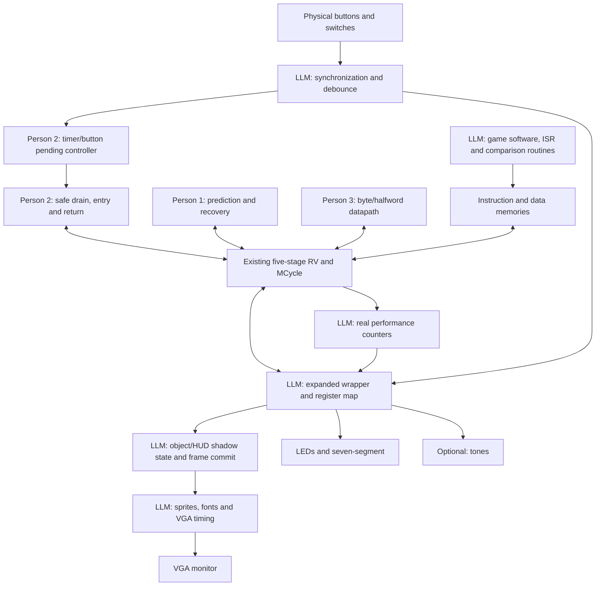

# Astra handover: build Neon Space Defender on the enhanced Lab 4 CPU

Prepared: **2026-11-04, Asia/Singapore**.

> **Implementation update:** The game is now implemented under `lab4/demo/`.
> Start with [the game build/test guide](../demo/TESTING.md) for current controls,
> interfaces, verification results and the dedicated `NeonTop` build. The body
> below is the pre-implementation handoff. FPGA synthesis/programming remains
> to be completed on a usable Vivado installation; this environment reported
> no valid Vivado license.

Intended recipient: a fresh coding agent with this document and access to the repository. You do not need the earlier conversation to understand the assignment. All paths below are relative to the repository root unless explicitly stated otherwise.

## 1. Your mission

Build **Neon Space Defender**, a small, polished, playable FPGA VGA arcade game running on the team's existing five-stage RISC-V processor. Complete the surrounding hardware, software, performance instrumentation, integration, tests, and reproducible build material needed to demonstrate the processor enhancements convincingly.

This is an implementation handoff, not a request to produce another high-level proposal and stop. Inspect the actual checkout, establish the contracts below, and implement in small verified increments. Preserve the existing human work. The desired outcome is a working game and credible architectural comparisons, not merely a collection of peripherals or a test that lights an LED.

**Planning premise supplied by the user:** assume the enhancement test works perfectly and the three human enhancement tracks provide a functioning platform. Proceed toward building the game on that basis. This premise is not a historical claim that an agent has witnessed the FPGA pass. Preserve the evidence distinction in Section 5.

The key architectural constraint is that **the RISC-V software performs gameplay**: movement, bullet/enemy updates, collisions, damage, score, and waves. The display hardware renders CPU-published state. Do not implement the game in hardware and leave the processor writing decorative registers.

The user explicitly moved **performance counters from Person 3 to LLM responsibility**. You own their implementation and validation, as well as the performance display. Do not wait for Person 3 to build them.

## 2. Project background and user intent

The team has three students working on NUS CG3207 Lab 4, “Pipelining + Bells + Whistles.” Earlier work supplied a five-stage RV pipeline with ALU, registers, instruction/data memory, forwarding, load-use hazards, and a multicycle multiply/divide unit. The team selected an interactive space-defense game to demonstrate useful processor enhancements.

A stored-video-player idea was considered and abandoned because of memory-system complexity. Do not revive it. The intended system uses local program/data memories, compact sprite/font ROMs, display-object registers, and VGA timing. No DDR, cache, DMA, video decoding, operating system, camera, superscalar execution, or out-of-order implementation is part of this scope.

The enhancements are:

1. Person 1: dynamic branch prediction with target prediction and recovery.
2. Person 2: timer/button interrupts, pending/enable/acknowledge control, and safe pipeline entry/return.
3. Person 3: byte/halfword loads and stores, with correct memory lanes and forwarding.

The game must demonstrate these features meaningfully while still being understandable to the students. A good-looking game is helpful, but measured architectural benefit and explainable correctness are essential. Peripheral graphics alone are not a processor enhancement.

The original block diagram assigned the game, input conditioning, wrapper integration, object registers, renderer, VGA timing, performance overlay, and optional sound to LLM work. Its Person 3 performance-counter block is now also LLM-owned.

## 3. Read this first: facts, decisions and proposals

Use these categories throughout your work:

- **User decision:** build this game; keep gameplay on the CPU; transfer counters to LLM ownership; use the existing human enhancements as the platform.
- **Current implementation fact:** established by source inspection and explicitly described as such below. Recheck after source changes.
- **Planning assumption:** the enhancement suite succeeds. This allows development to proceed; it does not create verification evidence.
- **Suggested implementation default:** a concrete way to finish unspecified game or integration details. Adopt or refine it coherently, documenting the final contract.
- **Verified evidence:** a recorded build/test/tool result with a stated scope. Never silently promote assembly success or an architectural model result into RTL/FPGA validation.

Do not repeatedly ask the user to reconfirm settled scope or routine reversible implementation choices. Use reasonable defaults and make progress. Ask only for genuinely missing hardware facts or material product choices that cannot be resolved from the checkout; continue independent work while waiting. Do not claim a hardware action occurred without access to hardware.

## 4. Ownership and boundaries

| Track | Accountable owner | Your role |
|---|---|---|
| Predictor and recovery | Person 1 | Preserve behavior; add/integrate needed mode control and event exports with focused tests and a clear explanation |
| Interrupt controller and CPU entry/return | Person 2 | Preserve precise drain/resume behavior; implement game ISR using the real ABI; expose measurement events |
| Subword operations | Person 3 | Use documented semantics, preserve datapath/forwarding, add combined regression cases as needed |
| Performance counter bank | **LLM** | Design and implement events, MMIO, snapshots, tests and measurement definitions |
| Game software and comparisons | **LLM** | Implement startup, ISR, polling path, game, packed-data fallback, replay and benchmark modes |
| Display, inputs and integration | **LLM** | Complete input conditioning, display registers, sprites/fonts, VGA, top-level/constraints/build wiring |
| Optional audio | **LLM** | Add only after the required demo is working |
| Student understanding / board demonstration | Team | Provide explanations, repeatable commands, test records and instructions that the team can use |

Human ownership is not a prohibition on necessary integration edits. Make minimal, justified patches rather than independently replacing their designs. If a hardware bug blocks progress, capture a failing case, explain the fix, and preserve the verification history. Do not invent a new processor enhancement to compensate for unfinished application work.

The original person handoffs explicitly describe human-coordinated work; they do not authorize spawning agents or contacting people. “Astra” in this filename identifies the intended recipient, not authorization to delegate to another model. Follow the current session's delegation rules.

## 5. Progress and evidence at handoff

### 5.1 What exists

| Area | Current state |
|---|---|
| CPU pipeline | Five-stage implementation with stage-valid state, forwarding, load-use handling, MCycle launch/busy stalls, and gated side effects |
| Predictor | Integrated 32-entry tagged target table and two-bit direction counters; predicted-next-PC metadata and execute recovery |
| Interrupts | Integrated timer, pending/mask/ACK controller, drain-to-empty entry, saved continuation and handler return |
| Subwords | Integrated LB/LBU/LH/LHU/SB/SH, size metadata, load extension, store alignment and byte-write enables |
| Inputs | Three PBs synchronized; center button debounced with held level and press pulse; other movement PBs currently only synchronized |
| Memory wrapper | Active implementation under `lab4/old/Wrapper.v`, including memories, legacy peripherals and timer/IRQ MMIO |
| Debug outputs | Existing LEDs and eight-digit seven-segment display |
| Test software | Pipeline smoke program, branch/predictor self-test, subword self-test, new 234-case combined enhancement test |
| RTL tests | Eight dedicated timer/controller/handler/CPU/wrapper testbenches |
| Metrics | Free-running legacy cycle count and timer tick count only; dedicated performance bank still missing |
| Game and VGA | No complete game, VGA renderer, display-object bank or performance HUD implemented at this handoff |

### 5.2 What was actually checked by the previous agent

- The relevant Verilog design and all eight dedicated testbench tops compiled with Vivado 2026.1 `xvlog --sv` and elaborated with `xelab`.
- XSim failed at startup in the sandbox with `ERROR: unexpected exception when evaluating tcl command`. Its process exit status was zero despite the error. No RTL simulation PASS was established in that session. An outside-sandbox retry was declined; do not automatically repeat that approval request as though permission had already been given.
- The existing branch and subword assembly tests assembled with the repository's RARS 1.6 jar.
- `ENHANCEMENT_TEST.asm` assembled successfully.
- An independent temporary sequential RV32/MMIO sanity model completed all 234 enhancement cases, including simulated button actions, with monotonically increasing pass-count displays. This checks the software against that model, not real pipeline behavior or physical debounce.
- No fresh full mixed-language top build, synthesis, post-synthesis simulation, implementation timing validation or FPGA demonstration was completed by that agent.

Temporary review material was placed under `/tmp/lab4-audit/` and `/tmp/enhancement-review/`. These are session artifacts, not portable repository dependencies. The model/generator used to sanity-check the assembly is not a committed project tool. The assembly file is self-contained and does not require that generator.

### 5.3 User changes already present: preserve them

At the latest inspection:

- `lab4/old/Wrapper.v` already has **`IROM_DEPTH_BITS = 15`** and **`DMEM_DEPTH_BITS = 9`**.
- `lab4/AA_IROM.mem` is modified relative to Git. Its provenance/program identity was not established by this handoff. Do not replace it or infer that it is a verified enhancement/game image merely from its filename.
- The three original handoffs and their three person-folder copies have ownership-update notes.
- `lab4/handoffs/readiness_and_roadmap.md` and `lab4/ENHANCEMENT_TEST.asm` were added during the conversation and may still be untracked.

Inspect `git status` and diffs before editing. Do not reset, clean, overwrite, or “restore” these changes as housekeeping. Do not reorganize historical labs or rename `Pipline_Resgisters` merely to correct spelling.

### 5.4 How to use the assumption of enhancement success

Treat the enhanced processor as the intended working baseline and start implementation. If the user reports a board PASS, record the exact source/image/bitfile and result as new evidence. Do not force the entire previous audit to restart before making useful progress.

A successful board run still does not prove every microarchitectural property, every IRQ injection cycle, predictor accuracy, timing closure at another frequency, or any new integration edit. Preserve the regression suite and rerun relevant checks after changes. If a material failure appears, resolve it rather than continuing to build on a demonstrably broken contract.

## 6. Repository guide and reading order

Start with this document, then inspect the actual source at integration boundaries:

| Path | Purpose / important details |
|---|---|
| `lab4/RV.v` | Core, valid stages, prediction, memory interface, MCycle and central redirect/drain integration |
| `lab4/HazardUnit.v` | Forwarding, load-use stall cause, flushes and MCycle holds |
| `lab4/BranchPredictor.v` | 32-entry predictor, tag/index/target/counters |
| `lab4/IRQHandler.v` | Normal/drain/in-handler FSM, saved EPC, fixed handler address |
| `lab4/InterruptController.v` | Timer/button pending bits, mask, ACK, IRQ |
| `lab4/Timer.v` | Configured cycle interval and monotonically accumulating tick count |
| `lab4/ButtonDebouncer.v` | Debounces an already synchronized active-high input |
| `lab4/Subword.v` | Load formatting, store alignment/masks, current misalignment behavior |
| `lab4/MCycle.v` | Multiply/divide unit; this name is unrelated to a performance-counter CSR |
| `lab4/Pipline_Resgisters/*.v` | D/E/M/W metadata and register enables/flushes |
| `lab4/old/Wrapper.v` | **Active** memory/MMIO implementation; directory name does not mean unused |
| `lab4/old/Decoder.v` | Instruction decode, source of the broad SYSTEM-return behavior |
| `lab4/old/{ALU,RegFile,Extend,PC_Logic,ProgramCounter,Shifter}.v` | Current CPU dependencies |
| `lab4/old/TOP_Nexys.vhd` | Existing mixed-language board top, clock divider, reset, debug displays and peripheral connections |
| `lab4/old/TOP_Nexys4DDR.xdc` | Existing board constraints; VGA entries are commented |
| `lab4/Testbenches/*.v` | Dedicated enhancement test infrastructure |
| `lab4/ENHANCEMENT_TEST.asm` | Combined self-checking board suite; keep separate from game firmware |
| `lab4/{branch_predictor_selftest,subword_test,lab4_pipeline}.asm` | Existing directed regressions |
| `lab4/AA_IROM.mem`, `lab4/AA_DMEM.mem` | Current wrapper initialization filenames; inspect before changing |
| `lab4/lab4_vivado/lab4_vivado.xpr` | Existing Vivado project, source manifest currently incomplete for newer modules |
| `rars1_6.jar` | Available assembler; useful baseline toolchain |
| `lab4/lab4.pdf` | Local assignment reference; extracted text was incomplete |
| `lab4/handoffs/readiness_and_roadmap.md` | Earlier review and milestone plan; predates the current ROM-size change and new suite |

The three original handoffs are `branch_handoff.md`, `interrupts_handoff.md`, and `subword_handoff.md` under `lab4/handoffs/`. Their corresponding `person*/handoff.md` copies contain the same planning material. Their bodies describe an October 28 starting snapshot, with an ownership override added later. Do not treat statements such as “IRQ is commented out” or “no predictor exists” as current implementation facts. This document supersedes their outdated implementation status and Person 3 counter allocation.

The prior working environment was Linux with repository root `/home/d00/CG3207/labs`, Vivado binaries under `/home/d00/vivado2026/2026.1/Vivado/bin/`, Java available, and no `iverilog`/`verilator` found on PATH. Discover tools in your environment rather than hardcoding that installation location into portable scripts.

## 7. The game we want

### 7.1 Required experience

The player controls a ship near the bottom of a VGA screen, moves left/right, fires at enemies, survives waves, and sees score/health and selected processor/demo modes. It should feel like a coherent small arcade game, not a software diagnostic disguised as one.

Initial scope:

- One player.
- Four enemies.
- Four active player bullets.
- Start/restart flow, active play, game-over state, and wave progression.
- CPU-driven movement, firing, collision, damage, scoring and enemy updates.
- Difficulty selection and comparison modes applied at safe boundaries.
- A readable VGA HUD with score, health, wave and mode labels.
- Performance numbers sourced from actual measurement, including cycles per update and branch behavior.
- LEDs/seven-segment provide useful debug/status information.

Increase object counts only after the small version works. Audio is optional. A full software framebuffer is not required and is not the initial architecture.

### 7.2 Concrete defaults you may adopt

These gameplay details are suggested defaults, not previously frozen requirements:

- A 640×480 presentation with integer-coordinate objects and a fixed software update period.
- A title/menu screen with control hints and selected modes, then playing, game-over, and restart states.
- A player ship that clamps to horizontal playfield bounds.
- A finite bullet pool; fire allocates an inactive slot, respects a cooldown and cannot overrun the array.
- Enemies move horizontally and descend/reverse at bounds, or follow another small deterministic pattern.
- Axis-aligned rectangle collision detection; deactivate a hit bullet exactly once and award score exactly once.
- Player damage on contact or enemy invasion, with a short cooldown/invulnerability rule to avoid losing all health in one update.
- Three starting health points, a fixed score increment per enemy, and a fresh enemy formation when a wave clears.
- Difficulty changes speed/cooldowns or wave parameters without changing simulation semantics between comparison modes.
- A dark background, bright contrasting ships/projectiles, a simple starfield, small hit flashes and readable text. Start with geometric sprites, then polish.

Write the chosen rules and constants down once and make the reference model/tests agree with them. Do not let rendering timing drive game rules accidentally.

### 7.3 Controls

Existing physical PB ordering is `PB[2]=left`, `PB[1]=center`, `PB[0]=right`. The current top uses separate up/down functions for pause/reset; inspect actual ports and constraints.

Suggested final mapping: left/right movement, center fire, up start/restart, down CPU reset. This would replace the old pause behavior and needs actual top-level wiring. It is a proposal, not an implemented mapping. Use switches for difficulty and comparison mode selection.

Keep game restart separate from CPU reset. Synchronize inputs, debounce the physical buttons, expose held movement levels and clean edge events, and sample switch settings when stable at a round boundary. Preserve the existing center press event source; do not connect raw button edges directly into the interrupt controller.

## 8. Existing CPU and memory contract

### 8.1 External CPU interface

The current `RV` exposes `CLK`, `RESET`, `IRQ`, `Instr`, `ReadData_in`, `MemRead`, four-bit `WriteMask`, `PCF`, `ALUResult`, and `WriteData_out`, with `PC_INIT` parameterization. Check exact declarations before wiring.

The wrapper uses asynchronous instruction and data reads. There is no ready/valid memory-response handshake. A synchronous block-RAM replacement cannot be dropped in without accounting for added latency in fetch, load capture, hazards and forwarding. Preserve this timing contract for the initial game build.

The memory-stage mask has one bit per little-endian byte lane. Forwarded store data is selected before subword alignment. Load formatting occurs before the W-stage result is used by forwarding.

### 8.2 Current memory sizes and addresses

| Region | Current implementation |
|---|---|
| IROM | Base `0x00400000`; `IROM_DEPTH_BITS=15`; 32 KiB, 8,192 words |
| DMEM | Base `0x10010000`; `DMEM_DEPTH_BITS=9`; 512 B, 128 words |
| Legacy MMIO | `0xFFFF0000–0xFFFF00FF` |
| Timer/IRQ | Explicit registers at `0xFFFF0100–0xFFFF0114` |
| Interrupt vector | `0x00400100`, selected in RV's IRQHandler instantiation |

Depth bits count **byte-address bits**, not number of source lines or number of words. Budget assembled instructions, expanded pseudo-ops, vector padding, constants, state and stack explicitly.

The new enhancement suite fits the current 32 KiB IROM and 512 B RAM. The game may need more data RAM. Evaluate a modest increase, such as 4 KiB, from a concrete layout and resource check; do not present that number as already required or implemented. Keep stack and state non-overlapping and define startup initialization.

### 8.3 Subword semantics

| Operation | Current behavior |
|---|---|
| LB/LBU | Any offset 0–3; signed/unsigned extension |
| LH/LHU | Offsets 0, 1, 2 work; crossing offset 3 returns zero |
| SB | Any offset 0–3; neighboring lanes preserved |
| SH | Offsets 0, 1, 2 work; crossing offset 3 suppresses store |
| LW/SW | Offset 0 only; misaligned loads return zero and stores are suppressed |

No split access or alignment trap exists. Use aligned halfwords and words in the game even though the current implementation supports within-word offset-1 halfwords. Preserve tested behavior during integration. Do not invent `sbu`; stores do not have signed/unsigned variants.

Use signed byte velocities and unsigned byte fields where meaningful; aligned halfword coordinates/timers are natural packed fields. Do not add pointless instructions merely to claim all subword instructions appear in gameplay. Distinguish instructions exercised by game code from those verified by tests.

### 8.4 Predictor and hazard behavior

The predictor has 32 direct-mapped entries indexed by `PC[6:2]`, tag `PC[31:7]`, valid/target/jump data and two-bit direction counters. Prediction metadata follows D/E. Execute compares actual and predicted next PC; correct predicted-taken branches must not flush merely because they are taken.

The predictor currently has no externally selectable bypass mode. Add one for comparison while preserving execute recovery and hazard handling. Define table warm-up/reset/training policy. A correct baseline predicts sequential `PC+4` and recovers normally; disabling hazards is not a valid baseline.

Existing central redirect logic handles return, entry, prediction recovery and ordinary predicted fetch. The interrupt drain must allow older redirects and MCycle work to complete. Do not create a second competing PC-control module.

## 9. Existing MMIO and interrupt ABI

### 9.1 Registers software can already use

| Address | Function | Notes |
|---|---|---|
| `0xFFFF0060` | LEDs | Existing low-byte write behavior; default eight output LEDs |
| `0xFFFF0064` | DIP switches | Currently raw switch readback; complete synchronization/latching for game |
| `0xFFFF0068` | Pushbuttons | Synchronized PBs; center bit replaced with debounced held state |
| `0xFFFF0080` | Seven-segment value | Eight hexadecimal nibbles; byte-lane writes supported |
| `0xFFFF00A0` | Free-running CPU cycle count | 32-bit wrapping count, reset by RESET |
| `0xFFFF0100` | Timer period | Staging register, read/write |
| `0xFFFF0104` | Timer control | Full-word write applies staged period and bit-0 enable; read zero |
| `0xFFFF0108` | Total timer ticks | Read; preserved by reconfiguration, reset by RESET |
| `0xFFFF010C` | IRQ enable mask | Timer bit 0, center-button bit 1 |
| `0xFFFF0110` | Pending bits | Events remembered while masked |
| `0xFFFF0114` | ACK | Write one to clear each source; read zero |

Timer/IRQ control writes require aligned full-word stores; subword writes are ignored. Keep game peripheral control accesses word-sized. UART/OLED/accelerometer addresses also exist in the legacy window; preserve interfaces used by the final top and tests, and avoid unintended address aliases when expanding decode.

The timer captures its period/enable on a control write and restarts the interval. Period zero generates no events. A repeated event can coalesce into one pending bit. The pending update gives a new event priority over an ACK in the same cycle. Tick-count differences, not pending-bit counts, represent elapsed timer intervals.

### 9.2 Entry and return

The processor stops fetch admission, drains admitted instructions, waits for MCycle completion, saves the correct continuation, and enters the handler. It blocks nesting while in the handler. Pending events can remain for service after return. General registers are not automatically saved; the ISR must preserve every register it modifies, including `ra` if it calls functions.

The saved EPC is internal; there is no general CSR-based interrupt architecture. Treat this as the project's simplified ABI.

**Critical assembler compatibility detail:** the current decoder treats every SYSTEM opcode `0x73` as return. RARS 1.6 supports `uret` (`0x00200073`) but not `mret`, and rejects `.word` in the text segment. Therefore `ENHANCEMENT_TEST.asm` uses `uret` to invoke the current hardware's custom return. It does not claim standard user-privilege interrupt semantics. The earlier roadmap's reference to `0x30200073` describes the MRET word, but is not sufficient RARS source guidance.

For the game, either preserve this documented current return convention, or deliberately migrate assembler and decoder together with regression updates. Do not tighten decoding to exact MRET and leave all RARS firmware broken. Do not emit ECALL, EBREAK, CSR accesses or ordinary SYSTEM instructions into this processor assuming standard semantics.

Use a small fixed-address vector stub that jumps to an out-of-line handler. The enhancement suite puts the reset jump at `0x00400000`, vector stub at `0x00400100`, main at `0x00400200`; this is a useful pattern, not a requirement to reuse the suite's state addresses in the game.

### 9.3 Game ISR and scheduling

Initialize stack, variables, input/event state and timer settings before enabling IRQs. The ISR should record ticks/input events and return quickly. Keep collision detection and display publication in the main loop.

Prefer a monotonic producer counter/sequence and a main-owned consumed sequence over a shared flag that the ISR sets while main clears it. If using read/clear flags, provide an explicit exclusion protocol so a new event cannot be lost between the read and clear. Hardware IRQ masks do not inherently make every software data structure atomic.

Use the same timer and input-latch semantics in polling and interrupt modes. Handle elapsed tick counts explicitly: decide how many pending simulation updates to process, cap catch-up if necessary, and record missed deadlines/backlog using a documented policy. Do not silently run the game faster in the faster processor mode.

## 10. Performance instrumentation: your responsibility

Build a real counter block, meaningful event exports, software readout and tests. The existing `cycle_count` is useful but is not the requested complete counter bank.

Suggested initial metrics:

| Metric | Definition / current candidate signal |
|---|---|
| Cycles | CPU cycles while measurement enabled; state explicitly whether ISR work is included |
| Retired instructions | Once per valid advancing W-stage instruction, including stores, branches and real NOPs; candidate `ValidW && !RESET` for this fixed-latency pipeline |
| Conditional branches | Once per valid resolving conditional branch; candidate `NotNOPE && isBranchE` |
| Conditional mispredictions | Candidate `NotNOPE && isBranchE && MispredictE` |
| Load-use stall cycles | Qualified `LwStall`; document overlap with MCycle or use exclusive cause categories |
| MCycle stall cycles | Launch/busy stall cycles, not arithmetic instruction count |
| IRQ entries/returns | Actual entry/return pulses, not request level |
| IRQ latency | Explicit source-event timestamp to entry or first software marker; report which endpoint |
| Game updates / missed deadlines | Software accounting based on defined tick and work completion semantics |

`MispredictE` also covers jump/target mismatches, so it cannot be used unqualified as the conditional-branch misprediction count. `RegWriteW` is not a retirement event. A held stage must not count repeatedly; wrong-path instructions and invalid bubbles must not count.

Export explicit ports for synthesizable integration rather than hierarchical references to RV internals. Hierarchical observations are acceptable in testbenches, not a substitute for the peripheral interface.

Implement enable/clear/atomic snapshot. Start with 32-bit wrapping counters and bounded measurement windows. Freeze semantics for reset, clear, snapshot and count occurring together. A snapshot must provide a coherent multi-register view while live counters continue or stop according to the documented contract.

Events resolve in different pipeline stages. Define measurement boundary behavior and test instructions already in flight when measurement starts/stops; a pair of MMIO writes is not automatically an exact instruction-boundary bracket. Also account for snapshot/control instruction overhead consistently.

Latency needs a precise source/coalescing rule. Preserve the first event timestamp of a pending episode or implement another documented policy. For simultaneous timer/button sources, identify the measured source. Do not call debounce delay “CPU interrupt latency.” Do not infer missed events from a single pending bit.

### Honest comparison rules

- Same clock, initial state, random seed, input stream, simulation ticks and workload.
- Predictor enabled versus bypass, with documented warm-up policy.
- Polling versus interrupts on the same conditioned inputs/events and an honest polling cadence. Interrupts are not guaranteed to improve every metric.
- Direct subwords versus correct word/mask/shift extraction/merge on the same packed data layout.
- Equivalent shared-data atomicity in both subword/fallback modes.
- Identical final gameplay state/checksum is required before claiming equal-work comparison.
- Prefer cycles/update, branch rate/mispredictions, latency and deadlines to “FPS” when VGA refresh limits visible output.
- Exclude measurement formatting/render publication from the measured region when appropriate, and document what is included.
- Never manufacture speedup with extra busy waits, broken hazards, corrupted fallback state, or different gameplay speed.

One firmware image should contain the comparison routines/modes. Do not require unrelated firmware uploads for every demonstration unless a concrete limitation is documented and accepted.

## 11. Proposed new MMIO and software data contracts

These windows came from the original plan. They are **reserved proposals**, not already implemented registers:

| Window | Intended function |
|---|---|
| `0xFFFF0200–0xFFFF02FF` | Counter control/snapshot/readback |
| `0xFFFF0300–0xFFFF03FF` | Game/display control, HUD, capabilities, selected mode and commit status |
| `0xFFFF0400–0xFFFF04FF` | Object bank: up to 16 slots × 16 bytes |
| `0xFFFF0500–0xFFFF05FF` | Optional sound |

Before implementing software, freeze a table of offsets, reset values, access permissions, byte-enable policy, side effects, and commit handshake. Extend actual wrapper decode; writing new addresses in assembly does not create registers. Avoid low-bit-only decode that aliases the old peripherals.

Maintain one authoritative definition source and generate/include equivalent RTL and assembly constants where practical. If the toolchain makes generation awkward, keep one simple documented pair with an automated consistency check.

Keep compact CPU game state separate from display state. Suggested RAM fields are aligned halfword coordinates, signed byte velocities, unsigned byte health/type/active flags and word-sized shared counters. Define every offset/alignment/signedness. Use one layout for enhanced and fallback routines.

Display slots can be word-oriented records for x/y or packed position, sprite/type, color, and flags/size. Sixteen slots fit the initial player/four-enemy/four-bullet scope with room for effects. Final packing is your choice; keep it small and documented. The renderer must not modify authoritative game state.

For testability, include deterministic replay controls or a software replay mode and final-state checksum. Provide a fixed seed or fixed scripted wave. Separate debug capabilities from physical user-facing controls.

## 12. Display, VGA and clock integration

### 12.1 Rendering

Implement continuously running VGA timing, visible-region qualification/blanking, sprite/font lookup and priority/compositing. Give objects explicit visibility bounds and deterministic overlap priority. Test off-screen coordinates and blanking so invalid indexes cannot read arbitrary sprite data.

Start with a stable test pattern and simple objects, then add ship/enemy/projectile shapes, score/health/wave text and the measurement overlay. Sprite ROMs can be simple code-native bitmaps; no external art-generation service is required.

The HUD should distinguish score/gameplay information from comparison metrics. Display actual software-published counter snapshots, selected modes and valid units. Do not fabricate values or show an unavailable metric as zero without identifying it.

### 12.2 Coherent frame publication

CPU updates must not tear across visible frames. Use shadow and active display state with an explicit commit request and acknowledgment. CPU finishes a frame payload, requests commit, and keeps the transfer payload stable until acknowledgment. Pixel logic adopts a complete payload at the chosen frame boundary.

If domains differ, a synchronized request/acknowledge toggle or equivalent coherent mailbox can work. Synchronizing every data bit independently is not enough. Define what happens if CPU requests a second commit while one is pending, and how independent reset affects toggles/ownership. Prevent simultaneous writes to a payload being transferred. Test delayed acknowledgments and back-to-back software publications.

### 12.3 Clock/reset facts and choices

The existing board top uses a 100 MHz input and `CLK_DIV_BITS=3`, producing 6.25 MHz CPU clock. XDC currently uses `-divide_by 16`, matching that implementation. Its comment still describes an older divide-by-2^20 setting and is stale.

Center debounce is 62,500 CPU cycles, approximately 10 ms at 6.25 MHz. Recalculate debounce and timer constants if clocks change.

The old PAUSE function freezes the divider. It must not freeze VGA timing. Use proper FPGA clock resources or a deliberately constrained clock/enable design for the final system, and define reset assertion/deassertion in each domain. Do not derive pixel timing from CPU stall/MCycle enables.

Choose and document a supported VGA mode/pixel clock using the actual board and toolchain. A clocking resource/IP choice must be reproducible in the build; do not silently rely on an untracked GUI-generated IP project. Verify final pin mapping for the actual board revision. Nexys4 DDR is the working assumption from files/part, not a fresh user confirmation of the physical board.

## 13. Enhancement test suite: preserve this baseline

`lab4/ENHANCEMENT_TEST.asm` is a standalone regression image, not the game.

| Case range | Coverage |
|---|---|
| 1–95 | Existing CPU/branch/jump/MCycle directed tests |
| 96–191 | Existing subword lane, sign, sentinel and misalignment cases |
| 192–195 | All 256 byte values at each of four lanes, stores and signed/unsigned loads |
| 196–198 | All 65,536 halfword values at each supported offset 0/1/2 |
| 199–210 | Immediate LB/LBU/LH/LHU to SB/SH/SW forwarding combinations |
| 211–220 | Timer/controller/configuration/masking/ACK/entry/return/delayed-handler cases |
| 221–230 | Mixed branch/subword/MUL/DIV foreground with timer periods 1, 2, 7, 17, 31, 64, 127, 257, 509, 1021 |
| 231–234 | Manual masked press, unmask/hold, release, combined timer/button pending |

Display behavior:

- Initially `00000000`.
- Decimal-digit number of **completed** cases after each pass.
- `DEADdddd` on first failure, decimal case identifier in the low digits.
- `C001B33F` only after all 234 pass, including button tests.
- A hard CPU hang leaves the last completed count; use an external simulation watchdog.

LED prompts: `01` press and hold center, `02` keep holding, `04` release, `08` press and hold again; `FF` means all passed. Boot with buttons released and avoid presses during automatic cases. There is also an initial release check before the first prompted press. Timeouts assume 6.25 MHz; update both `CPU_HZ` and `BUTTON_TIMEOUT` when changing clocks.

Assembled size is **4,990 words / 19,960 bytes**, including vector padding/pseudo expansion. End-exclusive text address is `0x00404DF8`. Depth 15 is required; depth 14 is too small. The suite initializes its RAM itself and does not depend on a new data image.

Suite-specific RAM layout: scratch `0x00–0x3F`, result fields `0x40–0x4F`, IRQ state `0x80–0xBF`, stress scratch `0xC0–0xDF`, ISR stack frame `0x1E0–0x1FF`, relative to `0x10010000`; stack starts at `0x10010200`. Preserve these when running the suite, but give the game its own explicit layout.

The user previously requested the suite as assembly only and did not need a hexadecimal conversion. Do not replace the existing ROM image just to regenerate this test. For the game build, provide explicit image-generation/install steps and keep test/game images in distinct build locations so choosing a target is deliberate.

The suite cannot exhaust every pipeline state or measure branch accuracy. Do not present its “all values” subword sweeps as exhaustive processor verification.

## 14. Build, simulation and hardware evidence

### 14.1 Source manifest

The existing `.xpr` references the current `old/` dependencies and top `TOP`, with part `xc7a100tcsg324-1`. At review it omitted `BranchPredictor.v`, `IRQHandler.v`, `InterruptController.v`, `Timer.v`, and `ButtonDebouncer.v`. Its simulation top was `TOP`, not the dedicated tests. Reinspect and correct the actual source set before trusting GUI builds.

A known Verilog CPU/wrapper test source set, relative to `lab4/`, is:

```text
RV.v HazardUnit.v MCycle.v BranchPredictor.v Subword.v
IRQHandler.v InterruptController.v Timer.v ButtonDebouncer.v
Pipline_Resgisters/DRegister.v Pipline_Resgisters/ERegister.v
Pipline_Resgisters/MRegister.v Pipline_Resgisters/WRegister.v
old/Wrapper.v old/ALU.v old/Decoder.v old/Extend.v
old/PC_Logic.v old/ProgramCounter.v old/RegFile.v old/Shifter.v
Testbenches/<selected-test>.v
```

Do not glob multiple labs into a build; they contain duplicate module names. Full board builds also need the selected VHDL top/dependencies and new video modules. Add portable Tcl/scripts rather than relying exclusively on GUI state.

### 14.2 Existing tests

Dedicated tops are:

```text
test_Timer
test_InterruptController
test_IRQHandler
test_RV_Interrupt
test_Wrapper_TimerIRQ
test_Wrapper_TimerIRQ_BoardImage
test_Wrapper_ButtonIRQ
test_Wrapper_CombinedIRQ
```

`test_RV_Interrupt` has a retirement reference model and interrupt injection scenarios, useful for integration changes. Some wrapper benches embed programs; others assert specific contents of the current memory image. Give each a reproducible fixture. A mutable `AA_IROM.mem` shared by unrelated tests is not a sound regression configuration. Several older tests under `old/` have stale interfaces and should not be assumed compatible.

Run each in an isolated build directory with its chosen memory files. Typical Vivado sequence is `xvlog --sv <sources>`, `xelab <test-top> -s <snapshot>`, `xsim <snapshot> -runall`. Check explicit completion/PASS markers and failures/timeouts, not just shell exit status. Some benches use `$finish` on error.

RARS assembly-only validation from the repository root can use:

```sh
java -Djava.awt.headless=true -jar rars1_6.jar nc a ae1 lab4/ENHANCEMENT_TEST.asm
```

RARS can assemble firmware but does not execute this custom wrapper/interrupt hardware. If Java preference writes are sandbox-blocked, use an allowed temporary preferences directory rather than changing user settings.

### 14.3 Historical reports and bitfiles

Ignored local Vivado output contains a `TOP.bit` and synthesis/implementation reports. The previously inspected routed timing report is dated October 30 and constrains the CPU clock to 10,485,760 ns (about 95 Hz), unlike today's 6.25 MHz configuration. Its “timing met” result is not evidence for the current source/clock or a maximum-frequency claim.

Rebuild the final design with real constraints. Record source revision/diff, firmware image identity, target part, clock settings, tool version, utilization, timing and bitfile identity. Changes to memory initialization may require explicit synthesis reruns; do not assume Vivado notices an externally replaced `.mem` file.

Keep these evidence categories separate: source inspection, assembly, architectural-model test, behavioral RTL simulation, post-synthesis simulation, routed timing/resource analysis, and physical board behavior.

## 15. Dependency-ordered implementation plan

### Phase A — Establish a usable integration baseline

1. Inspect user changes and available tools; read current interfaces.
2. Preserve the enhancement suite and existing images.
3. Create a source manifest, isolated test fixtures and reproducible commands.
4. Freeze the memory map, vector/stack/ISR convention, clock assumptions and proposed peripheral contracts.
5. Record the enhancement success assumption or supplied board evidence accurately.

**Deliverable:** a concise contract/build record and a baseline that can be reproduced. Do not spend the entire task rewriting documentation before implementing useful game/display components.

### Phase B — Add observability and comparison control

1. Add explicit event ports without changing instruction behavior.
2. Implement `PerformanceCounters` or equivalent with MMIO/snapshots.
3. Add predictor bypass/reset policy and a safe mode configuration path.
4. Validate short hand-counted traces, counter boundaries, reset/rollover and wrong-path/stall exclusions.

**Gate:** exact counter tests pass and prediction modes produce identical architectural results. This phase can overlap independent video work but precedes measurement claims.

### Phase C — Build one visible end-to-end path

1. Complete input conditioning needed for movement/start/fire.
2. Add display shadow/active registers and commit handshake.
3. Generate VGA timing and a test pattern.
4. Render one CPU-controlled object.
5. Write a tiny polling firmware that moves it from button input and publishes state.

**Gate:** input → CPU → MMIO → coherent visible display works, while CPU stalls do not stop video. Use simple graphics first.

### Phase D — Complete the baseline game

1. Define packed state, startup/stack and game states.
2. Implement movement, bullets, enemies, collision, health, score, wave/restart.
3. Use fixed simulation timing and the shared event/input model.
4. Start with polling and correct word/mask packed-data routines.
5. Add deterministic replay and state checksums.

**Gate:** playable small game; collision edges, object allocation, screen bounds, wave transition, game over and restart have defined tested outcomes.

### Phase E — Integrate enhanced modes and measured HUD

1. Add direct subword routines using the same layout.
2. Add the small register-preserving ISR and interrupt scheduling path.
3. Add safe between-round comparison selection.
4. Compare equal work with deterministic replay and matched final state.
5. Publish real snapshots and metrics to the HUD.

**Gate:** all modes work, no update/input loss under the defined coalescing policy, no register corruption/duplicate side effects, and comparisons are reproducible.

### Phase F — Board integration and delivery

1. Finalize top, pin constraints, clock/reset and coherent display crossing.
2. Run full integration simulation, synthesis, post-synthesis simulation and implementation checks as available.
3. Validate actual board controls, video stability, complete game loop and measurement modes.
4. Package source, assembly, image build commands, demonstrated bitfiles, evidence and presentation material.

**Gate:** a teammate can rebuild the correct target and reproduce the demonstration from the recorded instructions. Clearly identify any board-only steps that could not be performed in the agent environment.

Optional sound and visual effects follow these gates. Do not make them dependencies of core gameplay or honest measurement.

## 16. Acceptance tests for the new work

At minimum, add meaningful tests for:

- MMIO decode isolation, read-only/write-only behavior, reset and byte-enable policy.
- Counter exact counts, snapshot consistency, clear/enable/overflow, bubbles, stalls and wrong-path exclusion.
- Prediction-enabled/bypass architectural equivalence.
- VGA frame/line dimensions, sync/blanking and stable output during CPU stalls.
- Frame commit coherence, CPU faster/slower than display, request while pending and reset on both sides.
- Debounced held levels/presses, repeated presses, synchronized mode selection, reset/restart distinction.
- Firmware startup with arbitrary previous RAM contents; initialized stack and ISR shared state.
- Register preservation through timer/button interrupts during game updates and MCycle activity.
- Bullet pool exhaustion/reuse, double-hit prevention, off-screen removal, collision boundaries and wave progression.
- Deterministic input replay across polling/IRQ, predictor modes and packed-data implementations.
- Long-run tick wrap/difference semantics and deadline accounting over bounded intervals.
- Game state checksum equality for comparisons, before collecting speedup numbers.

Use a software reference for gameplay where helpful, but also run on the actual RTL. A software model cannot catch wrong-path stores, duplicated retirement, or broken clock-domain transfer in the hardware.

## 17. Assignment and repository constraints

The original handoffs summarize these assignment requirements: compulsory pipeline functionality should be preserved; demo must have useful input/output and an interesting purpose; processor enhancements should be defensible; one assembly program can contain comparison modes; post-synthesis simulation and FPGA demonstration are required; final material includes sources/software/bitfiles and 3–6 slides. Confirm exact submission/deadline details from the readable authoritative assignment; no deadline is established here.

Retain educational-use/copyright notices in source and derivatives. Course sources contain a prohibition on public-repository posting. Do not publish them as a side effect of creating a demo or collaboration artifact.

Preserve course arithmetic restrictions: do not replace the required MCycle multiply/divide hardware with synthesizable variable `*` or add unnecessary parallel CPU arithmetic units. Peripheral arithmetic is not automatically subject to the exact same restriction as the CPU datapath; read the assignment before interpreting it. Do not claim full RV32IM/privileged compliance just because a subset of tests passes. Prefer controlled handcrafted assembly initially; a C toolchain needs an explicit ISA/ABI/linker audit.

Avoid large unrelated refactors, new speculative features and dependencies that complicate the small FPGA demo. Keep software and build tools understandable to the team.

## 18. Suggested repository deliverables

Choose names consistent with the repository; these are examples, not files that already exist:

```text
lab4/PerformanceCounters.v
lab4/<display register and frame commit modules>.v
lab4/<VGA timing, sprite and font modules>.v
lab4/<completed input conditioning>.v
lab4/<game top or carefully extended existing top>
lab4/software/<game assembly and shared register definitions>
lab4/scripts/<assemble, simulate, build and image selection commands>
lab4/Testbenches/<new counter, MMIO, display and game integration tests>
lab4/<game/ABI/build documentation>
```

Keep firmware source and named build outputs separate from the currently selected board image. Maintain a regression table with exact commands, expected completion signatures and results. Keep a short current-status record so the next session knows which milestone was completed and what concrete issue remains.

When reporting progress, state what changed, why, what actually ran, and remaining limitations. Do not leave users to infer verification from source presence or successful compilation.

## 19. Architecture after the ownership change



## 20. First-session checklist for the receiving agent

1. Read this file and inspect the working-tree changes. Preserve them.
2. Treat enhancement success as the user's planning premise; do not fabricate a board-pass record.
3. Verify active wrapper sizes, vector/return encoding and source manifest before touching firmware.
4. Choose/freeze the minimal game MMIO and display publication contract.
5. Start building the first visible CPU-controlled slice and the counter infrastructure in dependency order; do not stop at another plan.
6. Keep the full game and credible measurements as the completion objective.
7. Record actual tests, artifact provenance and remaining board validation clearly.

The user should ultimately receive a playable, rebuildable Neon Space Defender demonstration whose CPU really runs the game, whose enhancement modes preserve the same game behavior, and whose displayed performance numbers come from measured events.
