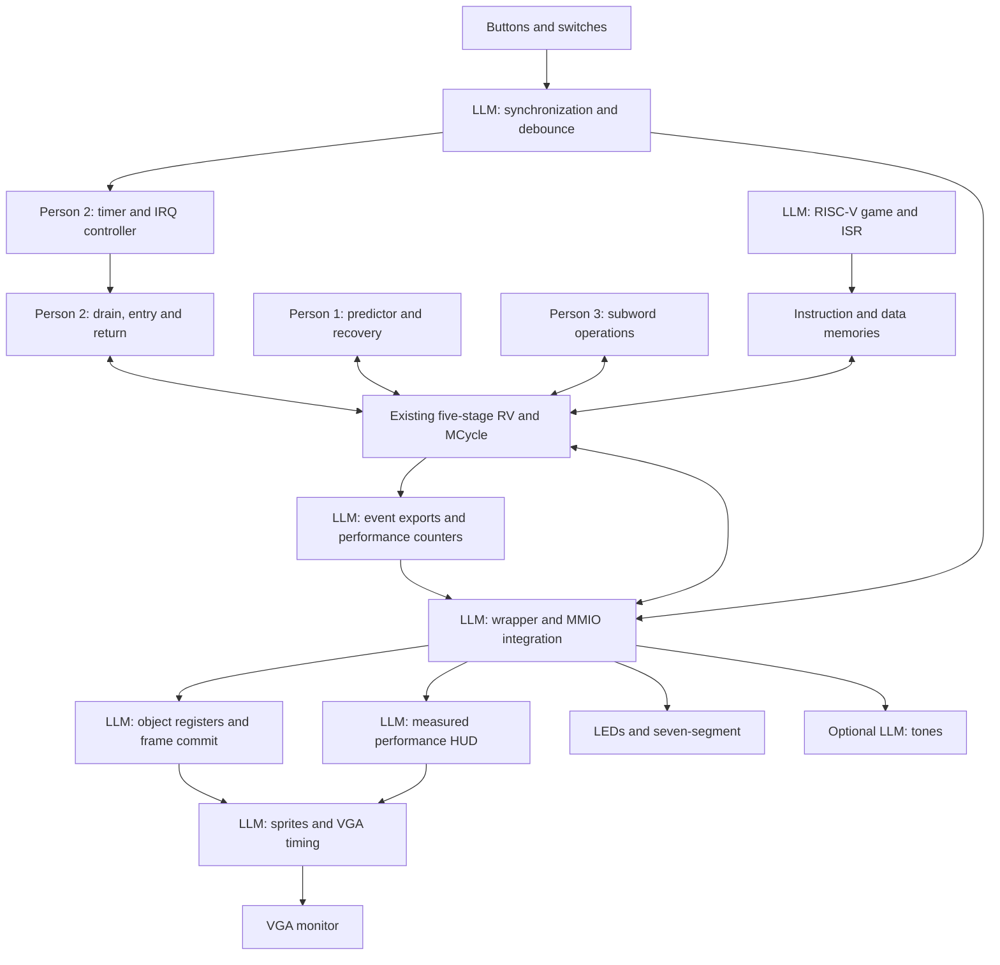

# Lab 4 readiness assessment and completion roadmap

Assessment date: 2026-11-04, Asia/Singapore. Scope: the current Lab 4 sources, all three original handoffs (and their identical person-folder copies), the supplied architecture diagram, tests, memory images, and local Vivado project/artifacts. This is an analysis and implementation plan; no game or RTL changes were made during this review.

## Decision

**Yes: the human-owned components are sufficiently implemented for LLM development to begin. They are not yet sufficiently verified to declare the combined system complete.** Start the game, display, input, and counter work now. Make reproducible tests and a written interface contract the first integration milestone, rather than waiting for every human feature to be declared finished.

The project has an integrated enhanced CPU and peripheral test platform. It does not yet have a playable Neon Space Defender application. Counting source files or assigning a single percentage would obscure that distinction: all three human enhancement datapaths exist, while most of the game/presentation path in the diagram remains to be built.

## Responsibility change

| Owner | Responsibility from now on |
|---|---|
| Person 1 | Branch predictor correctness, recovery, bypass/reset semantics, focused verification and review of branch event definitions |
| Person 2 | Timer/controller, precise drain/entry/return, interrupt ABI, review of event/latency definitions and ISR preservation |
| Person 3 | Subword datapath, alignment policy, forwarding/byte-mask correctness, focused subword verification |
| LLM implementation, team reviewed | Performance counter RTL, CPU event exports, MMIO/control/snapshots, counter tests, reproducible integration harness, game/ISR software, input conditioning, display registers, VGA/sprites/HUD, top-level integration and optional audio |
| Team with board access | Confirm board/pins, review generated work, perform hardware demonstrations, explain enhancements and report measured results |

Counter ownership moves in full, including measurement verification. Person 3 is not the prerequisite owner for counters anymore. Event exports still touch human-owned CPU logic and must preserve its semantics. Each human continues to own defects in their enhancement.

The six original handoff files now carry an explicit superseding ownership note. Their old checklists and snapshot facts are retained as history, not current status.

## Progress against the supplied diagram

| Diagram block | Current evidence | Assessment / remaining work |
|---|---|---|
| Five-stage RV + forwarding/stalls/MCycle | `RV.v`, `HazardUnit.v`, pipeline registers, `MCycle.v`, support modules under `old/` | Integrated foundation. ValidD/E/M/W now exist; invalid memory/register side effects are gated. MCycle launch is tracked once per instruction. Full regression execution remains to be reproduced. |
| Person 1 predictor | `BranchPredictor.v`; predicted-next-PC in D/E registers; `RV.v` recovery | 32 tagged direct-mapped entries, 2-bit counters, stored targets, jump prediction, valid/advance-qualified training. Recovery compares actual and predicted next PC. Missing runtime bypass/control and exported metrics; standalone predictor behavior tests are absent. |
| Person 2 timer/button controller | `Timer.v`, `InterruptController.v`, `old/Wrapper.v` | Implemented timer, total tick count, enable/pending/ACK, event-wins-over-ACK semantics, timer/button IRQ wiring. Strongest collection of dedicated tests. |
| Person 2 entry/return | `IRQHandler.v`, `RV.v`, `old/Decoder.v` | Normal/drain/handler states, saved EPC, fixed vector, drain-aware fetch admission, return redirect. ABI documentation and precise return decoding need attention. |
| Person 3 byte/halfword operations | `Subword.v`, decoder, E/M size metadata, W load result, wrapper byte writes | All six requested operations implemented. Load formatting occurs in M before W capture/forwarding; store forwarding precedes alignment. Explicit misalignment behavior exists in code/test comments but differs from the original aligned-only scope. |
| Performance counters, now LLM | Legacy `cycle_count` at `0xFFFF00A0`; timer tick count | Partial foundation only. No dedicated retired/branch/mispredict/stall/IRQ/latency counter bank, enable/clear/snapshot interface, or overlay. `MCycle` is the arithmetic unit, not this counter bank. |
| Input synchronization/debounce | `ButtonDebouncer.v`, wrapper PB_meta/PB_sync | All three PBs synchronized; only center is debounced and generates IRQ events. Left/right are synchronized held levels. Switches are read raw. Start/restart and comparison controls need definition. |
| Memory and MMIO wrapper | `old/Wrapper.v` | Real active implementation despite directory name. Async instruction/data reads; 8 KiB IROM and 512 B DMEM. Legacy peripherals and explicit timer/IRQ addresses work structurally; game/counter/object windows absent. |
| Game program | `lab4_pipeline.asm`, branch/subword self-tests, test ROM | Test software exists; movement, collision, waves, health, score and complete game state machine are absent. |
| Object/display registers | None found | Not built. Existing OLED pixel registers are not the proposed VGA object bank. |
| Sprite renderer + VGA timing | None found; VGA constraints commented | Not built. Existing OLED/VHDL peripherals can remain reference material but do not provide this VGA pipeline. |
| Performance HUD | None found | Not built; depends on counters and display path. |
| LEDs / seven-segment | Wrapper and VHDL top | Existing debug outputs reusable. |
| Optional sound | None found | Defer until playable game and required evidence are complete. |

## Concrete integration findings

### 1. Handoffs are planning documents, not implementation status

All three still say no enhancements were implemented when written. That describes their October 28 snapshot. Current RTL contradicts many of those historical observations: IRQ is connected, stage-valid bits exist, subwords are formatted, and predictor recovery is integrated. Do not regenerate those components from the old starting-point description.

### 2. The Vivado project needs repair before it is a reproducible build

`lab4_vivado/lab4_vivado.xpr` targets `xc7a100tcsg324-1`, top `TOP`, and references the active files in `old/`. Its explicit source list omits `BranchPredictor.v`, `IRQHandler.v`, `InterruptController.v`, `Timer.v`, and `ButtonDebouncer.v`. Its simulation top is also `TOP`, rather than one of the dedicated tests. Create an authoritative manifest/build script and reconcile the project with it.

There are local ignored synthesis/implementation reports and `TOP.bit`. They must not be mistaken for evidence that the current integrated source passed. The saved routed timing report is dated October 30 and constrains `cpu_clk` to 10,485,760 ns (about 95 Hz). Current top uses `CLK_DIV_BITS=3`, producing 6.25 MHz from 100 MHz; current XDC actually uses `-divide_by 16`, which matches. The XDC comment still incorrectly describes divide-by-2^20. Rebuild timing at the real clock and with the final source list. The old report's “constraints met” does not establish current timing closure or a maximum frequency.

### 3. Software has a usable interrupt interface, with restrictions

| Address | Existing behavior |
|---|---|
| `0xFFFF0100` | Timer period staging register; read/write |
| `0xFFFF0104` | Write control bit 0 to apply staged period and enable/disable; read returns zero |
| `0xFFFF0108` | Total generated timer ticks; preserved across configuration, reset by RESET |
| `0xFFFF010C` | IRQ enable mask: timer bit 0, center-button bit 1 |
| `0xFFFF0110` | Pending bits, readable even when disabled |
| `0xFFFF0114` | Write-one ACK; a simultaneous new event keeps its bit pending; read returns zero |

These control writes require aligned full-word stores. Keep software accesses word-sized. Pending bits coalesce events; use tick-count differences for elapsed updates and missed deadlines, not pending-bit counts.

Handler entry is hardcoded to `0x00400100` in RV. Reserve that region explicitly; put a startup jump at the ROM base and place main code beyond the handler reservation. Size the reservation from actual assembled output. There are no general privilege CSRs or automatic register saves. `Decoder.v` currently treats **every opcode 0x73** as MRET. Until narrowed, generated code must not use ECALL, EBREAK, CSR operations, or other SYSTEM instructions. Use the agreed return word `0x30200073` and keep it confined to the ISR. This is a simplified interrupt ABI, not full privileged RISC-V support.

The software contract still needs a stack region, saved-register set, handler/main shared data policy, acknowledgment sequence and startup order. Prefer a small ISR that captures events/ticks and returns; run collisions and game updates in main. Initialize stack and shared state before enabling IRQs.

### 4. Predictor comparisons need an actual control path

The predictor is always active except during reset. No switch/MMIO bypass exists. Add a stable mode that makes fetch predict `PC+4`, while retaining execute recovery and hazards. Document whether tables train while bypassed and invalidate consistently when switching modes. Start with mode selection at reset/between complete benchmark runs; live round-boundary switching needs an explicit safe transition.

`MispredictE` covers any next-PC mismatch, including jumps and potential stale-target recovery. It must not be reported directly as a conditional-branch misprediction count. Qualify with a resolving conditional branch.

### 5. Subword support is usable, but preserve its exact contract

Current little-endian byte accesses work at offsets 0–3. Halfword offsets 0, 1 and 2 are implemented; offset 3 produces zero on load and suppresses stores. Words require offset 0; unsupported offsets produce zero/suppress stores. No split-word access or exception mechanism exists. `subword_test.asm` explicitly documents this behavior.

For the game, align halfwords to 0/2 and words to 0. Person 3 should document whether the extra offset-1 support is intentional. Do not silently change it while integrating the game. Load-to-store forwarding and base-address dependencies deserve focused combined tests; M-stage ALU forwarding by itself carries a load address, so correctness depends on the existing stalls and W-to-M store path.

### 6. Inputs, clocks and memory need deliberate integration

Reuse center-button conditioning rather than building a second competing IRQ source. Extend the same approach to movement/start inputs as required; synchronize switches and latch multi-bit settings while stable at a round boundary. A possible mapping is left/right movement, center fire, up start/restart, down CPU reset, replacing the old pause function. Confirm board and physical mapping before final constraints.

Keep VGA timing running continuously; the old PAUSE behavior stops the CPU clock and must not stop video. Choose a clock/reset plan before display integration. If CPU and pixel domains differ, use a request/acknowledge frame-commit handshake with payload held stable across transfer; synchronizing each object bit independently is insufficient.

Budget game state, constants, stack, ISR saves and benchmark buffers before enlarging DMEM. The current 512 B can be restrictive. A provisional 4 KiB DMEM budget is reasonable to evaluate, not a verified requirement or resource result. Preserve async memory timing initially: changing to synchronous block RAM requires pipeline/interface changes.

## Verification performed in this review

- Read all three handoffs; their three person-folder copies were byte-identical before the ownership notes.
- Inspected RTL integration, pipeline metadata, support modules, wrapper/top/constraints, assembly tests, eight dedicated testbenches, and the local Vivado project/report inventory.
- Compiled the Verilog design and all eight dedicated testbenches with Vivado 2026.1 `xvlog --sv`. All eight tops elaborated with `xelab`.
- XSim failed at startup for every top with `ERROR: unexpected exception when evaluating tcl command`. Its process returned zero despite the error. **No simulation PASS is claimed.** The request to retry outside the sandbox was declined. Logs are in `/tmp/lab4-audit/` for this session.
- Assembled `subword_test.asm` and `branch_predictor_selftest.asm` with the repository's `rars1_6.jar`, using assembly-only mode and separate temporary text dumps. Java emitted preference-lock warnings; assembly commands completed. This does not execute the RTL or validate predictor timing.
- No fresh mixed-language top build, synthesis, post-synthesis simulation, timing closure, or FPGA run was performed. Existing historical artifacts are identified separately above.
- The local PDF's text extraction is incomplete; assignment requirements in this plan follow the supplied handoffs and should be checked against the readable original before submission.

Dedicated test tops: `test_Timer`, `test_InterruptController`, `test_IRQHandler`, `test_RV_Interrupt`, `test_Wrapper_TimerIRQ`, `test_Wrapper_TimerIRQ_BoardImage`, `test_Wrapper_ButtonIRQ`, `test_Wrapper_CombinedIRQ`.

The CPU interrupt test contains a retirement reference model, directed hazards and an IRQ timing sweep; this is meaningful infrastructure to reuse. Test presence is not a pass result. Wrapper button/combined tests expect particular ROM contents; timer tests include embedded programs. Give every test its own named assembly/image fixture. A single mutable `AA_IROM.mem` cannot establish reproducibility for all variants. Button/combined assembly named or implied by tests is not present as a corresponding standalone source in the tracked Lab 4 inventory.

Reproduction source set, relative to `lab4/`:

```text
RV.v HazardUnit.v MCycle.v BranchPredictor.v Subword.v
IRQHandler.v InterruptController.v Timer.v ButtonDebouncer.v
Pipline_Resgisters/DRegister.v Pipline_Resgisters/ERegister.v
Pipline_Resgisters/MRegister.v Pipline_Resgisters/WRegister.v
old/Wrapper.v old/ALU.v old/Decoder.v old/Extend.v
old/PC_Logic.v old/ProgramCounter.v old/RegFile.v old/Shifter.v
Testbenches/<selected-test>.v
```

Run from an isolated directory containing the chosen `AA_IROM.mem` and `AA_DMEM.mem`: `xvlog --sv <source-list>`, `xelab <selected-test> -s <snapshot>`, `xsim <snapshot> -runall`. Check explicit PASS/FAIL text and timeouts, not exit status alone; several benches finish on failure without a nonzero process status. Legacy tests under `old/` need separate compatibility/image review and were not included in these eight elaborations.

## Completion roadmap

Each milestone should be a small reviewable change with its own tests. The filenames below are proposed deliverables, not existing implementations. No phase should replace human RTL wholesale.

| Milestone | Work to generate | Acceptance gate |
|---|---|---|
| 0 — Reproducible baseline and contracts | `scripts/` build/regression commands, explicit source manifest, per-test ROM fixtures, shared software/RTL MMIO definitions, memory/stack/vector map, interrupt ABI, corrected project source list | Dedicated tests actually run; failures recorded and assigned. No unknown fixture dependencies. Owners review the stable interfaces. |
| 1 — CPU observability and comparisons | Export event pulses; `PerformanceCounters.v`; counter MMIO; predictor bypass coordinated with Person 1; latency capture coordinated with Person 2 | Hand-counted traces match counters; no counts for bubbles/wrong path or repeated held instructions; snapshot/clear/overflow tests pass; enabled/bypass runs have identical architectural results. |
| 2 — Input and display transport | Complete button/switch conditioning, object/HUD shadow registers, frame commit/ack, wrapper address decode, clock/reset/top-level plan | MMIO read/write/reset tests pass; no unintended byte-lane effects; active display changes atomically; holding buttons produces defined events; CPU stalls do not freeze output timing. |
| 3 — Visible vertical slice | VGA timing, simple sprites/font, one player and enemy, minimal polling assembly that moves/fires and publishes object state | Stable monitor output and one complete input → CPU → MMIO → display path. Simulated raster boundaries/blanking and commit behavior are checked. Start with simple shapes. |
| 4 — Complete baseline game | Startup/stack, menu/start/play/game-over/restart states, player + four enemies + four bullets, movement, collisions, damage, scoring, wave progression, fixed-step scheduling | Deterministic replay produces expected game-state checksums. Boundary/collision/bullet reuse/wave/restart tests pass. Game runs with polling and word/mask fallback routines. |
| 5 — Enhanced game modes and measurement HUD | Short ISR, polling/IRQ modes on shared event state; packed subword routines and equivalent fallback; predictor modes; counter snapshots and cycles/update overlay | Same seed/input/tick schedule produces identical final state across modes. No lost/duplicate updates, register corruption or torn display state. Report IRQ latency and deadline misses with precise definitions. |
| 6 — Final FPGA and submission evidence | Final build Tcl/project, pin/clock constraints, synthesis/implementation, post-synthesis test, board validation, tagged ROM/bitfile pair, reports and 3–6 slides as described in handoffs | Timing checked at actual clocks; correct bitfile/image demonstrated on confirmed board; measurements reproducible; source and build provenance recorded. |
| Optional polish | Tones, explosions, starfield, additional enemies | Only after required game and verification gates pass. |

Milestones 2 and standalone renderer work can start while CPU owners close milestone 0 failures. The game can be developed against the agreed MMIO model during that time. Full enhanced integration and performance claims depend on milestones 0/1 passing. A playable baseline does not need the finished overlay or audio.

### Counter implementation contract to freeze in milestone 1

Keep the existing free-running cycle register compatible. Add the proposed `0xFFFF0200–0xFFFF02FF` counter window with documented enable, clear, atomic snapshot and readback behavior. Use 32-bit counters initially with explicit wraparound and bounded measurement intervals; record reset/clear/count/snapshot priority.

| Event | Candidate signal/definition from current RTL |
|---|---|
| CPU cycles | One per CPU clock while measurement is enabled; include main and ISR work initially |
| Retired instructions | `ValidW && !RESET` on each advancing W clock in this fixed-latency design; includes stores, branches and real NOPs, not merely `RegWriteW`. Verify against the reference test before exporting. |
| Conditional branches | `NotNOPE && isBranchE` |
| Conditional mispredictions | `NotNOPE && isBranchE && MispredictE` |
| Load-use stalls | Export the hazard unit's qualified `LwStall`; define overlap with MCycle (prefer exclusive cause categories) |
| MCycle stall cycles | `MCYCLESTALL && !RESET`; include launch and busy according to documented definition |
| IRQ entries/returns | `InterruptTaken` / `ReturnFromInterrupt`, gated outside reset |
| IRQ latency | Capture CPU-cycle timestamp of the first accepted source event in a pending episode; sample at entry or an explicit first-software-action marker. Report which definition, source and coalescing policy apply. |

Current valid-stage metadata makes counters feasible now. Export real ports rather than relying on hierarchical internal references in synthesizable peripheral logic. Branch events resolve in E while retirement is in W; measurement start/stop boundaries need a documented pipeline policy. Prefer drained boundaries or account for instructions already in flight. Snapshot before reading/displaying metrics so the display code does not contaminate the measured interval.

### Game and rendering contract

Reserve proposed windows `0xFFFF0300–03FF` for display/game control, `0xFFFF0400–04FF` for 16 object slots of 16 bytes, and `0xFFFF0500–05FF` for optional sound. These are proposals requiring actual wrapper decode, not existing registers. Preserve the current `0xFFFF0000` legacy and `0xFFFF0100` IRQ windows.

Keep CPU-owned packed game state in RAM. A suitable initial record uses aligned halfword coordinates and byte-sized health/type/velocity, with signedness documented per field. Publish expanded word-sized display records containing position, sprite/type, color and visibility. Gameplay stays in RISC-V software; rendering hardware only draws the published state. CPU software writes HUD values derived from real snapshots.

Begin with polling, shared event latches and word/mask routines. Add direct subword operations on the same packed layout, then the interrupt path. Keep shared ISR/main structures word-sized or explicitly protected so the fallback read-modify-write path has equivalent semantics. Use a fixed simulation tick schedule: faster CPU execution creates headroom rather than faster enemies.

### Suggested sequence of LLM work requests

1. “Repair the source manifest and test fixture setup; run the baseline tests; document the exact existing MMIO/ISR/memory ABI. Preserve hardware behavior and report failing cases.”
2. “Implement tested performance counters and explicit CPU event exports, with the agreed comparison control. Validate counts against short traces before displaying them.”
3. “Build input conditioning, display register transport and VGA timing; demonstrate CPU-controlled movement of one object.”
4. “Implement the complete small polling game with deterministic replay and CPU-owned collision/wave logic.”
5. “Integrate interrupt and subword comparison modes, then the performance HUD; prove equal final game state for equal work.”
6. “Produce and validate the final board build, timing evidence, ROM/bitfile provenance and demonstration material.”

Each request should include this roadmap, the current source tree, the frozen ABI and the latest passing/failing regression record. Produce code in dependency order, rather than asking for the entire game in one unverified generation.

## Updated ownership/dependency diagram



The human enhancements are the usable starting platform. The next concrete step is milestone 0 alongside independent display/game development; final readiness follows from passing integration gates, not from the historical handoff checkboxes.
